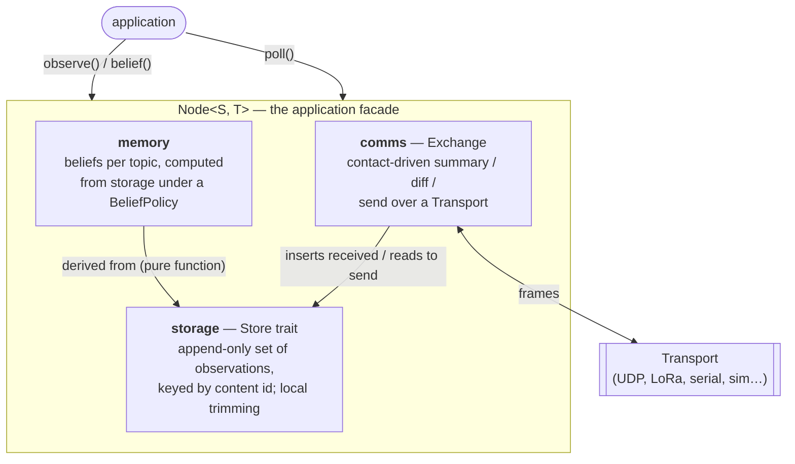
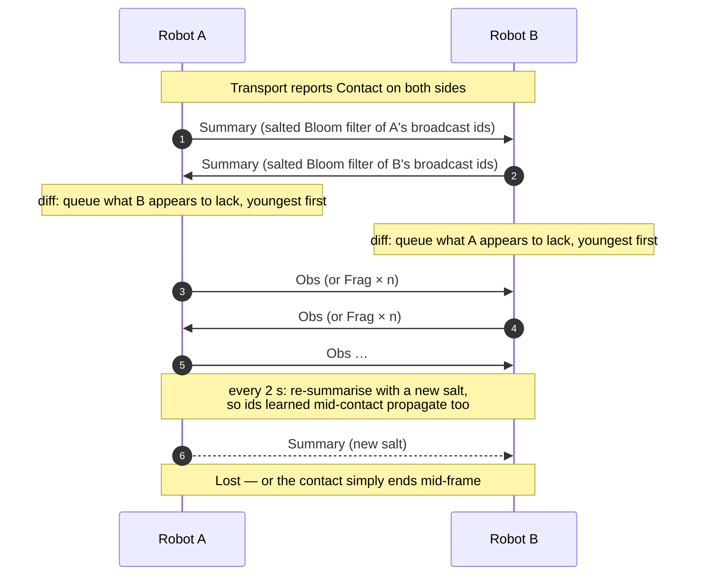
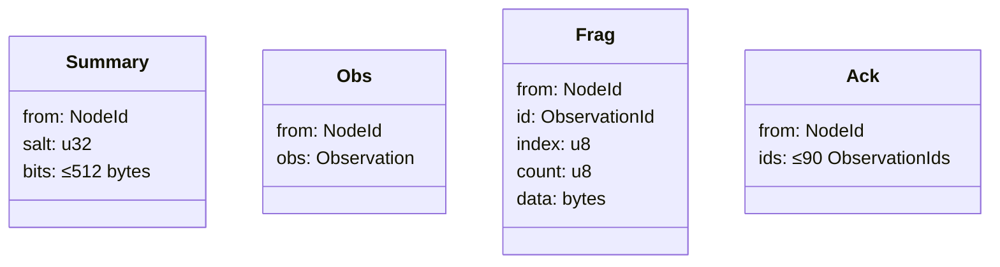
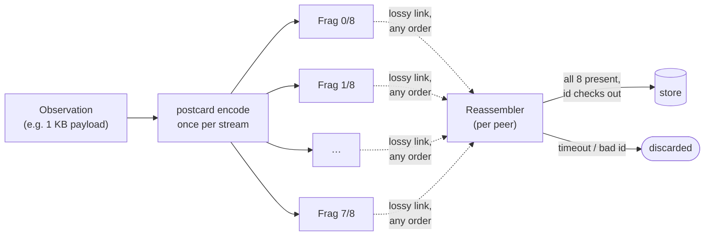
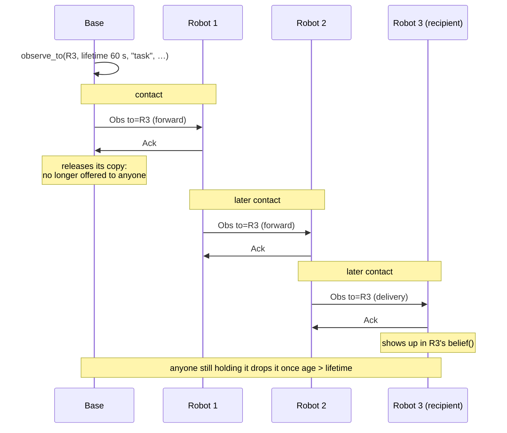
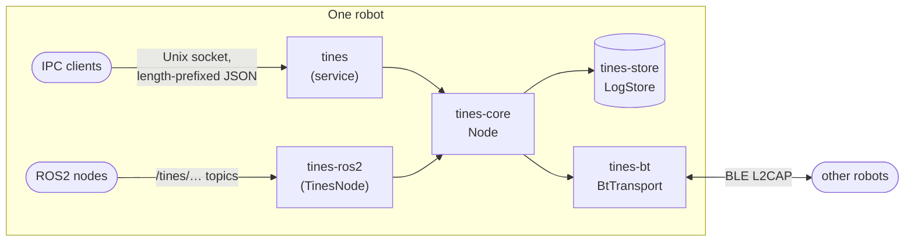

# tines — opportunistic shared memory for mostly-offline robots

Small robots doing their work collect facts about the world. They are mostly
offline, so when two of them happen to meet in range they swap what they know so
that each robot's picture of the world improves over time. No robot *depends* on
receiving anything — it can do its job on its own observations — but there is no
reason not to share.


`tines` is the library that does this: a store of timestamped-by-age
observations, a belief layer derived from them, and a delay-tolerant exchange
protocol that runs over whatever datagram link the robot has. The name is from
Vinge's *A Fire Upon the Deep*: the Tines only form a mind when close enough to
hear each other.

## Contents

- [Design at a glance](#design-at-a-glance)
- [Architecture](#architecture)
- [Observations](#observations)
- [The exchange protocol](#the-exchange-protocol)
- [Addressed delivery](#addressed-delivery)
- [Receipts](#receipts)
- [Usage](#usage)
- [Writing a transport](#writing-a-transport)
- [Writing a store](#writing-a-store)
- [The simulator](#the-simulator)
- [Running on a robot](#running-on-a-robot)
- [Crate layout](#crate-layout)
- [Building and CI](#building-and-ci)
- [Stability](#stability)
- [Security](#security)
- [Where to read more](#where-to-read-more)

## Design at a glance

- **Sharing is opportunistic, never load-bearing.** A contact may be cut off
  at any frame. Two nodes' stores converge given enough cumulative contact
  time; no single contact promises anything.
- **Order doesn't matter.** Storage is synced by set union over content-derived
  ids, so a node ends up with the same store whether it met B or C first.
- **The MCU is a first-class target.** `tines-core` is `#![no_std]`, has no
  async, threads, or I/O, and builds without an allocator for
  `thumbv7em-none-eabihf`. Every buffer is fixed-size.
- **Untrusted input never panics.** Every frame off the wire is decoded
  defensively; malformed bytes are dropped.
- **The application sets the pace.** `Node::poll` emits at most one frame per
  call, so duty cycle and airtime are the application's call.
- **No trust layer yet.** Anyone in radio range can read and inject. See
  [Security](#security).

## Architecture

Three layers, each a separate concern, top to bottom:



| Layer   | Holds                              | Crosses the wire? |
|---------|------------------------------------|-------------------|
| memory  | beliefs, recomputed on demand      | never             |
| storage | raw observations                   | yes, by set union |
| comms   | per-peer exchange state            | carries the frames |

Only observations cross the wire. Memory is a pure function of storage plus a
policy and is never transmitted, so two robots can hold different beliefs about
the same facts — that is expected, not a bug.

## Observations

An `Observation` is the unit of storage and exchange:

| Field         | Meaning                                                        | In the id? |
|---------------|----------------------------------------------------------------|:----------:|
| `observer`    | `NodeId` (`[u8; 16]`) of the robot that saw it                 | ✓ |
| `seq`         | the observer's sequence number                                 | ✓ |
| `topic`       | what it is about, ≤ 64 bytes (`b"door/3"`)                      | ✓ |
| `payload`     | opaque bytes, ≤ 1024                                           | ✓ |
| `dest`        | `None` for broadcast, or `Some(Dest { to, lifetime_ms })` for an addressed observation | `to` only |
| `age_ms`      | how old the observation is: a lower bound that every holder advances |   |
| `observed_at` | the observer's wall-clock time (ms since the Unix epoch), or `None` if it had no trusted clock |   |
| `sig`         | a reserved `Signature` slot (algorithm + up to 64 bytes); carried verbatim, signed and verified from 1.1 |   |

The **content id** is the first 16 bytes of Blake2s-256 over the ✓ fields
(`dest.to`, but not `dest.lifetime_ms`). Because age, timestamps, lifetimes
and signatures are excluded, the same fact arriving by two different paths, at
two different ages, dedupes to one entry.

`Observation` is `#[non_exhaustive]`: build one with `Observation::broadcast`
or `Observation::addressed`, or let `Node::observe` / `Node::observe_to` do it.

### Time is relative

Robots don't share a clock, so the protocol carries *age*, not time. Each call
takes a local monotonic `Tick` (milliseconds), and a store reports an
observation's current age as:

```
current_age = age_ms_at_insert + (now − stored_at)      // saturating
```

When an observation is sent, it goes out with its current age, so age keeps
accumulating across hops. A tick that goes backwards (after a reboot, say)
saturates rather than underflowing.

### Sequence numbers must survive reboots

`seq` is part of the id, so a robot must not reuse one for different content.
Pass `Node::new` a `first_seq` that is higher than any seq used before,
typically `boot_count << 32`, with a boot counter persisted across reboots.
`tines-store`'s `LogStore` keeps that counter for you: seed the node with
`store.first_seq()`. A repeated `seq` with identical content simply dedupes
(`insert` returns `Ok(false)`).

## The exchange protocol

When two robots come into range, both run the same symmetric procedure;
neither is the initiator.



- **Summaries** are 512-byte salted Bloom filters (k = 3). On a narrow link
  the filter is folded down to the largest power of two that fits the MTU. A
  false "peer has it" only delays propagation; the salt changes every round, so
  a different set of ids is affected each time.
- **Diffs** are sent youngest-first, on the theory that short contacts should
  carry the freshest data. Each peer's queue holds up to 256 ids.
- **Every frame is self-contained and idempotent.** Duplicates, reordering and
  loss are all harmless; there is no session state to corrupt.

### Wire frames

Every frame starts with a `WIRE_VERSION` byte (4 for wire v1), followed by
the [postcard](https://docs.rs/postcard)-encoded frame. Each frame carries the
sender's `NodeId`, so the core never needs to map transport addresses to
robots. A frame with another version byte, trailing bytes, or anything else it
can't decode is dropped and counted (see [Receipts](#receipts)).



A transport that binds a connection to a peer's identity can check a frame's
claimed sender with `tines_core::frame_sender`, without decoding the
whole frame.

### Fragmentation

An observation that doesn't fit the transport's MTU is split into up to 64
`Frag` frames (65 bytes of each frame are reserved for the version byte and
the header). Each peer
has one stream in flight at a time, and it is finished before anything else
starts for that peer. All fragments of a stream are cut from one encoding, so
the receiver can always reassemble them. A partial observation is never
stored; the receiver discards it after 5 s.



### What one `poll()` does

`Node::poll` drains inbound transport events, then emits **at most one**
frame:


## Addressed delivery

Most observations are broadcasts: everyone gets everything. An observation can
also be **addressed** to one robot with `Node::observe_to`, e.g. a tasking from
a base station. Addressed messages travel along a **custody chain**: a message
has one custodian at a time, and each handoff is confirmed by a receipt before
the old custodian lets go.



- A custodian offers the message to the recipient when it meets it
  (**delivery**), and otherwise to any peer it meets (**forwarding**).
  Delivery is preferred. Custody and broadcast take turns for each peer, so
  neither can starve the other.
- The receiver acks only once it has stored the message. When the ack comes
  back, the sender **releases** its copy: the copy stays in its store until
  it expires or is trimmed, but is never offered again.
- If an ack is lost, the sender keeps offering the message, so a message can
  briefly have two custodians. That costs airtime, never the message. A
  custodian that fails after handing the message on does lose it; that's
  accepted.
- Addressed messages **never appear in a summary**, so their existence doesn't
  leak to unrelated robots through gossip.
- **Bounce suppression:** within one contact, a robot never offers a message
  back to the peer it came from, or to a peer that already has it.
- **Expiry is local and silent.** A message older than its `lifetime_ms` is
  never forwarded and never stored. There are no end-to-end delivery reports
  and no cancellation messages.
- `belief()` sees broadcasts and messages addressed *to me*. Messages carried
  for others exist only to be forwarded.

## Receipts

Each robot acknowledges what it receives with `Ack` frames, sent as it goes
during a contact (up to 90 ids per frame), for both kinds of observation:

| Kind      | What an ack means to the sender                                        |
|-----------|-------------------------------------------------------------------------|
| addressed | custody has moved: release my copy                                      |
| broadcast | confidence only: "peer P has observation X"; nothing changes in storage |

An ack is accepted only from a peer the id was actually sent to during the
current contact. A robot never acks an observation it failed to store (for
example, because its store is full), and never acks an addressed duplicate
it has already released, since that would hand custody back to a robot that
no longer carries the message.

Broadcast confirmations surface as `NodeEvent<A>::Delivered { peer, id }` from
`Node::drain_events`. Frames this node received but couldn't use are counted
under a `DropReason` (`VersionMismatch`, `Malformed`, or `IdentityChanged` for
a peer whose `from` changed mid-contact) and surface as
`NodeEvent::Dropped { addr, reason, count }`, keyed by the sender's transport
address (see the `drop` reporting in the `tines` service and the ROS2 node).
The event queue is bounded (64, dropping the oldest), and drops go to a small
counted table with one overflow counter (`addr: None`), so drops are always
reported even under a chatty peer. Events are telemetry: losing one never
loses data.

## Usage

`tines-core` exposes a single application-facing facade, `Node<S, T>`, generic
over any `Store` and `Transport`:

```rust
use tines_core::{LatestWins, MemStore, Node, NodeId, TrimPolicy};

let me: NodeId = [7; 16];
let boot_count = 0u64; // persisted and incremented on every boot
let store = MemStore::new();
let transport = /* any Transport implementation */;

// first_seq must not repeat across reboots. With tines-store's LogStore,
// pass store.first_seq() instead.
let mut node: Node<MemStore, _> = Node::new(me, boot_count << 32, store, transport);

// Record something you saw. observed_at is an optional absolute clock
// (ms since epoch); `now` is a local monotonic Tick on every call.
let id = node
    .observe(b"door/3", b"open", Some(1_700_000_000_000), 0)
    .expect("observation fits the size limits");

// Address a tasking to one robot; it is carried until delivered or 60 s old.
node.observe_to([9; 16], 60_000, b"task", b"inspect door/3", None, 0)
    .expect("observation fits the size limits");

// Drive the exchange in your loop. Returns how many new observations were
// stored this round.
let stored = node.poll(500);

// Ask what you believe about a topic prefix, under a belief policy
// (e.g. the youngest observation wins).
let belief = node.belief(b"door", &LatestWins, 500);

// Which peers have confirmed holding which of your broadcasts, and which
// frames the peer dropped and counted.
for event in node.drain_events() {
    match event {
        tines_core::NodeEvent::Delivered { peer, id } => {
            println!("peer {peer:?} has {id:?}");
        }
        tines_core::NodeEvent::Dropped { addr, reason, count } => {
            println!("dropped {count} frame(s) from {addr:?}: {reason:?}");
        }
        _ => {} // NodeEvent is #[non_exhaustive]
    }
}

// Keep the store bounded.
let mut policy = TrimPolicy::default();
policy.keep_per_topic = Some(4);
policy.max_age_ms = Some(3_600_000);
policy.max_count = Some(10_000);
node.trim(&policy, 500);
```

`observe` rejects an oversized topic or payload with `ObserveError::TooLarge`;
nothing is ever truncated.

### Belief policies

A `BeliefPolicy` folds the matching observations, one at a time and in no
particular order, into a single belief. Nothing is buffered, which matters
with 1 KB payloads on an MCU. Two policies ship:

| Policy       | Picks                                                                   |
|--------------|-------------------------------------------------------------------------|
| `LatestWins` | the youngest observation; ties broken by `(observer, seq)`              |
| `SelfFirst`  | my own youngest observation if I have one, otherwise like `LatestWins` |

Write your own by implementing `BeliefPolicy::step` (for example, a majority
vote or a weighted average over payloads). Because beliefs are recomputed from
storage, changing policy never requires touching stored data.

### Trimming

`Store::trim` applies a `TrimPolicy` locally. In order, it keeps the N youngest
observations per topic, drops anything older than `max_age_ms`, then drops the
oldest observations until `max_count` remain. Trimmed ids aren't tombstoned:
if a peer offers one again later, it's accepted.

## Writing a transport

A transport is the boundary with the physical link. It only has to move
datagrams and report who is in range:

```rust
pub trait Transport {
    type Addr: Clone + PartialEq + core::fmt::Debug;
    fn poll(&mut self) -> Option<Event<Self::Addr>>; // Contact | Lost | Frame
    fn send(&mut self, to: &Self::Addr, frame: &[u8]) -> Result<(), SendError>;
    fn mtu(&self) -> usize;                           // ≤ 1500
}
```

- **Datagram semantics.** Frames may be lost, duplicated or reordered; the
  protocol assumes nothing more.
- **Contact detection is the transport's job:** a beacon heard, a link
  coming up, or the simulator saying "in range". A frame from an address with
  no prior `Contact` is treated as an implicit contact.
- **`Addr` is only a routing handle.** It can change mid-contact (DHCP,
  roaming) without harm.
- **Report back-pressure honestly.** Return `SendError::Busy` when the radio
  can't take a frame right now; the exchange will offer the same frame again
  on the next poll. `TooLarge` tells the exchange to give that frame up.
- **Mind the MTU.** `mtu()` must be at most 1500. Core can carry every valid
  observation from 85 bytes up; below that it never sends an oversized frame,
  but it sends less (see `Transport::mtu`'s docs for each floor).
- **Binding identities?** A transport that binds a connection to a `NodeId`
  can check each frame's claimed sender with `tines_core::frame_sender`.

## Writing a store

`MemStore` (behind the default `alloc` feature) is the reference backend. A
flash or SQLite backend implements the `Store` trait:

| Method                  | Contract                                                                 |
|-------------------------|--------------------------------------------------------------------------|
| `insert`                | `Ok(true)` if new; `Ok(false)` for a known id, leaving the existing entry (and its age) untouched; `Err(StoreError::Full)` when out of room |
| `contains`              | whether an id is stored                                                  |
| `get`                   | the observation with `age_ms` advanced by `now − stored_at`, saturating if `now` is earlier |
| `len`                   | number of stored observations                                            |
| `for_each_id`           | every stored id, any order                                               |
| `for_each_broadcast_id` | ids with `dest == None`; these feed the summary                          |
| `for_each_addressed_id` | ids with `dest == Some(_)`; scanned for custody on every poll            |
| `release`               | mark an id as handed off, so it's never offered again; a no-op if the id isn't stored |
| `is_released`           | whether an id has been released; a re-inserted observation starts un-released |
| `for_each_topic`        | age-adjusted observations whose topic starts with a prefix               |
| `trim`                  | apply a `TrimPolicy` (per-topic, then age, then count); return how many were removed |
| `is_empty`              | `len() == 0` (default provided)                                          |
| `flush`                 | the durability point and the time anchor for ages after a restart; harmless twice, an earlier `now` is clamped; returns `Err(StoreError::Backend)` on failure and leaves the store usable (default: no-op `Ok(())`) |

The store must remember when each observation was inserted (`stored_at`, in
the caller's `Tick`s) so it can report current ages. `insert` may return
`Err(StoreError::Full)`; the exchange then doesn't ack, so the sender keeps
custody.

`for_each_addressed_id` has a default implementation that visits every id,
which is correct but makes the exchange read every broadcast observation on
each poll just to find the few addressed ones. Override it if your backend can
filter by `dest` cheaply, e.g. with an index or a separate table. The
filtering is only an optimisation: core re-checks `dest` and `is_released` on
every id a backend yields.

A store that keeps `sig` must return it verbatim. Core never calls `flush`;
the application decides how often, because on flash every flush costs wear.
A backend that holds data across power-off can also implement the opt-in
`WallClockStore` trait, which lets the host pass in trusted wall time through
`Node::set_wall_clock` (see [Trusted time](#trusted-time)).

With the `conformance` feature, `tines_core::store_conformance` checks a
backend against the trait contract (dedupe, age lineage, saturating ticks,
release, `sig` round-trip, trim order, no tombstones, `flush`).

## The simulator

`tines-sim` runs N nodes over a scripted contact trace with seeded loss and
duplication, and is the protocol's test harness:

```rust
use tines_sim::{Contact, ContactTrace, Sim, WorldConfig};

let mut trace = ContactTrace::default();
trace.contacts.push(Contact { start_ms: 0, end_ms: 5_000, a: 0, b: 1 });
trace.contacts.push(Contact { start_ms: 10_000, end_ms: 15_000, a: 1, b: 2 });

let cfg = WorldConfig { nodes: 3, mtu: 512, loss: 0.1, dup: 0.05, seed: 42 };
let mut sim = Sim::new(cfg, trace.clone());
sim.observe(0, b"door/3", b"open");
sim.run_until(trace.end());

assert!(sim.converged(&[0, 1, 2])); // 0 and 2 never met, but 1 carried it
```



```mermaid
gantt
    title The contact trace above
    dateFormat x
    axisFormat %S s
    section 0 ↔ 1
    in range :0, 5000
    section 1 ↔ 2
    in range :10000, 15000
```

The property tests (`tines-sim/tests/props.rs`) generate random traces and
check that:

- every pair of nodes that was ever transitively connected ends up with the
  same broadcast store;
- no store depends on the order of contacts;
- a store only ever grows during a run (union is monotone);
- garbage frames never panic and never change a store;
- an unexpired addressed message always has a holder, a custodian or its
  recipient, including when some robots' stores are full.

`tines-sim/tests/relay.rs` adds scripted relay scenarios: a message relayed
down a custody chain to its recipient, one that expires before it gets there
and is never stored, and a released duplicate that isn't acked.

## Running on a robot

`tines-core` is only the library. The host crates put it on a Linux robot
(a Pi, or a Jetson running ROS2):



A robot runs either the service or the ROS2 node, not both: each owns its
`Node` and its log.

- **`tines-store`**: `LogStore`, an append-only log file (format v2; an
  older log is refused with an error that says to delete it).
  - Each record is checksummed (CRC-32C). Recovery skips a corrupt record and
    truncates only a torn tail.
  - Releases are written as they happen.
  - A boot counter provides `first_seq()`.
  - `Store::flush(now)`, reached through `Node::flush`, writes a clock marker
    at `now` and fsyncs the log, so ages carry across a restart. An earlier
    `now` is clamped.
  - What the log held at open is quarantined until the host has trusted
    wall time (see [Trusted time](#trusted-time)).
  - The log is rewritten as a snapshot at open and after the wall-clock
    fold, through a `<log>.snapshot-tmp` file that's fsynced and renamed
    over it. That keeps the fold's results and ages across any number of
    reboots, and compacts the log.
  - The file is created `0600` and locked, so only one process can open it.
- **`tines-bt`**: BLE over BlueZ, using L2CAP SeqPacket channels (one
  frame per packet).
  - Every robot advertises its `NodeId` and scans. The smaller `NodeId`
    dials and the larger accepts.
  - A connection is bound to the advertised `NodeId`, and frames claiming
    any other sender are dropped.
  - Connections produce `Contact` and `Lost` events. See
    [`tines-bt/README.md`](tines-bt/README.md).
- **`tines`**: the standalone service, for robots without ROS2.
  - It runs the exchange on a poll loop and answers `Observe`, `Belief`,
    `Events` and `Status` requests on a Unix socket.
  - It's configured by a JSON file (below). Library users call
    `tines::serve(node, socket_path, clock, poll_interval_ms,
    peer_time_window_ms)`.
- **`tines-ros2`**: a ROS2 node.
  - It publishes each tines topic under `/tines/` and confirmed deliveries on
    `/tines/receipts`.
  - It turns messages on those topics into observations.
  - rclrs is behind the `ros2` feature, so the crate builds without a ROS2
    toolchain.

The service's config file is a JSON object. An unknown key is an error, so a
typo can't silently fall back to a default.

| Key                       | Default      | Meaning |
|---------------------------|--------------|---------|
| `node_id`                 | required     | this robot's `NodeId`, 32 hex chars |
| `peer`                    | required     | the one peer's `NodeId`, 32 hex chars |
| `log_path`                | required     | the `LogStore` log file |
| `socket_path`             | required     | the IPC Unix socket |
| `poll_interval_ms`        | 20           | exchange poll cadence |
| `trusted_clock`           | unset        | `"system"` to trust the system clock; the only accepted value |
| `peer_time_window_ms`     | 10000        | how long to collect peer time estimates before adopting the latest |
| `unknown_downtime_age_ms` | 24 h         | age floor for held broadcasts when the downtime is unknown |

The hosts use a monotonic millisecond clock that starts at 0 when the
process does.

### Trusted time

Ages are relative, but a robot that was powered off can't tell from ticks how
long it was off. So the hosts open the store before they know the wall time,
quarantine what it held (not offered, delivered or acked, but still deduped),
and adopt a trusted wall time **once per run**:

1. **A local source.** The service adopts the system clock at startup when
   `trusted_clock = "system"`. tines-ros2's `TinesNode` has
   `trust_system_clock(now)`, and `trust_wall_clock(wall_ms, now)` for an RTC
   or GPS reading; call one right after construction.
2. **Otherwise, peers.** From the first plausible estimate a peer's
   observations give (`observed_at + age_ms`), the host collects estimates
   for `peer_time_window_ms` (10 s by default; `set_peer_time_window_ms` in
   tines-ros2), then adopts the latest.
3. **Otherwise** the quarantine stays. The robot's own fail-safe is outside
   tines.

Only a wall time between 2026-01-01 and about 2126 is adopted
(`tines::trust::WALL_FLOOR_MS` and `WALL_CEILING_MS`), from a peer or from
the system clock. A board that booted before NTP and reads 1970 is logged and
ignored, and the host falls back to peers. Adopting a time runs the store's
fold and flushes at once. If the log's last clock marker carries a wall time
no later than the adopted one, the fold adds the downtime to held ages.
Otherwise the downtime is unknown: the fold expires held addressed messages
and floors held broadcasts at `unknown_downtime_age_ms`. From then on
the host stamps its observations' `observed_at`; before, they carry `None`.
`TinesNode::has_trusted_time` reports whether a time was adopted.

The system clock is read once, at startup. Under systemd, order the service
after clock sync:

```ini
[Unit]
Wants=time-sync.target
After=time-sync.target
```

`time-sync.target` only waits for a synced clock when the sync service
supports it (`systemd-timesyncd` with `systemd-time-wait-sync.service`
enabled, or chrony's equivalent).

Peer time is unauthenticated until 1.1, and an adopted time isn't corrected
while the host runs; see F19 in [`THREAT_MODEL.md`](THREAT_MODEL.md).

**Current limits** (tracked in [`THREAT_MODEL.md`](THREAT_MODEL.md)):
- The service talks to one configured `peer`.
- The hosts don't flush on a timer or at shutdown. The service flushes after
  64 productive poll rounds, and both hosts flush when they adopt trusted
  time.
- The host-hardening work (trim defaults, bounded channels, socket
  permissions, ROS2 isolation) hasn't landed.

The two-device BLE check in `tines-bt/README.md` hasn't been recorded yet.

## Crate layout

```
tines/
  tines-core/   no_std core: Observation, Store / Transport / BeliefPolicy
                traits, the exchange state machine, the `Node` facade, the
                in-memory store, and the reference belief policies.
                `alloc` is a default feature; without it, tines-core builds
                for thumbv7em-none-eabihf (only MemStore needs alloc).
  tines-sim/    std: the simulator, contact traces, and the convergence /
                order-independence / custody property tests.
  tines-store/  std: LogStore, the persistent append-only backend.
  tines-bt/     std: the BLE transport (BlueZ via bluer).
  tines/        std: the standalone service with Unix-socket IPC.
  tines-ros2/   std: the ROS2 node (rclrs behind the `ros2` feature).
```

The public constants, in `tines_core::consts`, are the wire constants. They
are frozen for wire v1: changing one is a `WIRE_VERSION` bump.

| Constant        | Value | Meaning                                  |
|-----------------|-------|------------------------------------------|
| `WIRE_VERSION`  | 4     | the first byte of every frame            |
| `MAX_TOPIC`     | 64    | topic bytes                              |
| `MAX_PAYLOAD`   | 1024  | payload bytes                            |
| `MAX_FRAME`     | 1500  | largest frame (and MTU) supported        |
| `SUMMARY_BYTES` | 512   | full Bloom summary size                  |
| `ACK_IDS_CAP`   | 90    | ids in one `Ack` frame                   |
| `MAX_SIG`       | 64    | signature bytes                          |
| `BLOOM_K`       | 3     | hash functions per id                    |

Local capacities and timings (peers tracked at once, the re-summary interval,
queue sizes, the idle-eviction window, and so on) are internal defaults, not
public API. They can change in a minor release, and a later 1.x release will
make them configurable.

## Building and CI

The toolchain is pinned in `rust-toolchain.toml`. `scripts/ci.sh` runs the full
gate — formatting, clippy and docs (warnings are errors), the test suite with
and without `alloc`, and the `no_std` build for `thumbv7em-none-eabihf`:

```sh
sh scripts/ci.sh
```

GitHub Actions runs the same script on every push to `master` and on every
pull request. Two more jobs run there:

- **MSRV:** builds `tines-core` on Rust 1.82 (its `rust-version`), with and
  without default features and for `thumbv7em-none-eabihf`. It builds only,
  because a test dependency needs a newer compiler.
- **Fuzz:** a scheduled nightly job runs `cargo-fuzz` on the `fuzz/` crate's
  `node` target, in both its random-bytes and adversarial-peer modes, and
  keeps any crash reproducer. A bounded proptest twin of the same harness runs
  in the normal test suite.

## Stability

tines-core 1.0 guarantees, within the 1.x line:

- **Wire:** every 1.x release speaks wire v1. Only new optional `Frame`
  variants may be added, plus new `SigAlgo` ids and signature versions within
  the 64-byte `MAX_SIG` budget. A wire-v2 change, including any post-quantum
  signature or a `MAX_FRAME` above 1500, ships as tines-core 2.0.
- **Identity:** `Observation::id` never changes within a major version, and
  should not change across majors unless the hash itself is broken.
- **API:** standard semver; MSRV bumps are minor. Public types are
  `#[non_exhaustive]` where new fields are plausible; a public trait may only
  gain methods with a default implementation (or a new opt-in trait — e.g.
  `WallClockStore` for wall-clock folds, which `Store` itself never carries).
- **Local behaviour** (capacities, timings, scheduling order, which candidate
  goes first) can change in a minor release as long as the protocol
  properties hold: custody always keeps ≥ 1 holder, receipts never shorten
  world state, and every frame fits `mtu()`.
- **Signatures:** 1.0 carries them; 1.1 signs and verifies them, without
  breaking the wire or the API.

## Security

tines has **no trust layer yet**, by design. Anyone in radio range can read
everything, inject observations under any identity, and take custody of
addressed messages. That's acceptable only where the radio environment is
trusted. Signatures are planned for 1.1, with room for them reserved in the
1.0 wire format.

[`THREAT_MODEL.md`](THREAT_MODEL.md) has the full assessment: trust
boundaries, adversaries, findings, and which spec fixes each one.

## Where to read more

The specs are authoritative; the plans argue from them.

- **Core design:** `docs/superpowers/specs/2026-10-16-tines-design.md`
- **Addressed delivery:** `docs/superpowers/specs/2026-10-18-tines-addressed-delivery.md`
  (its epidemic forwarding is superseded by the fleet spec's custody chain)
- **Fleet deployment:** `docs/superpowers/specs/2026-10-18-tines-fleet-deployment-design.md`
- **Fleet fixes:** `docs/superpowers/specs/2026-10-19-tines-fleet-fixes.md`
- **Host hardening (next for the hosts):** `docs/superpowers/specs/2026-10-19-tines-host-hardening.md`
- **tines-core 1.0 (implemented on `feat/tines-core-1-0`; publish pending):** `docs/superpowers/specs/2026-10-18-tines-1-0-design.md`
- **Threat model:** [`THREAT_MODEL.md`](THREAT_MODEL.md)
- **Plans:** `docs/superpowers/plans/`
- **Changes:** [`CHANGELOG.md`](CHANGELOG.md)
