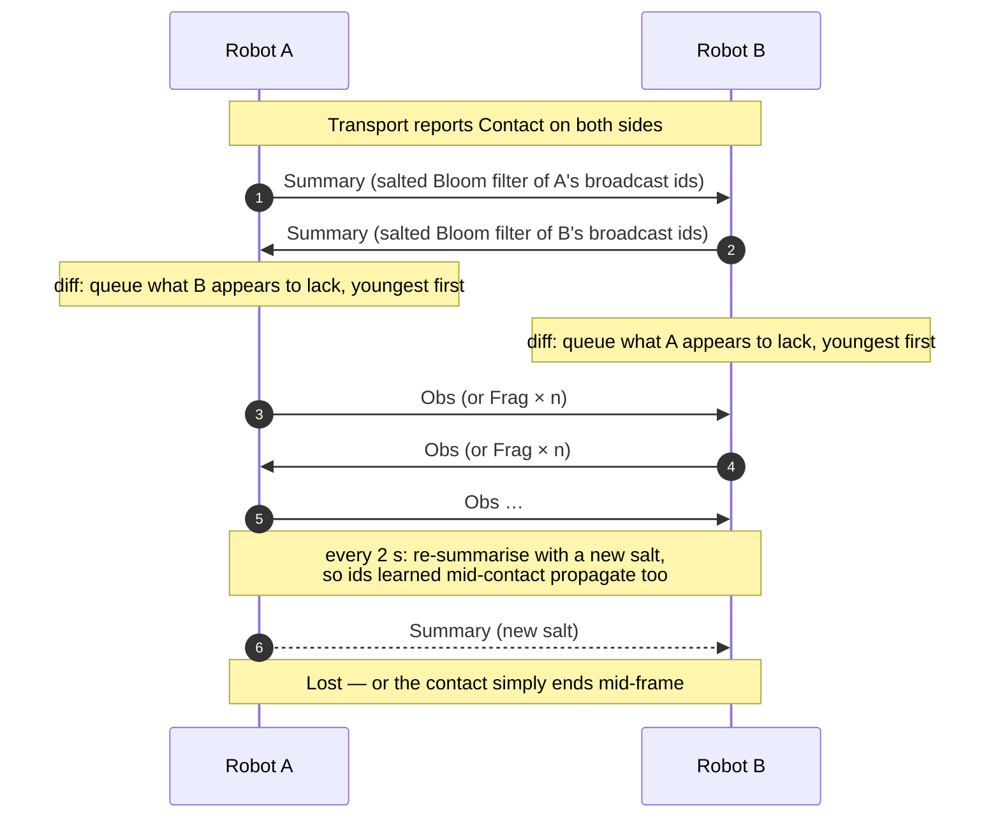
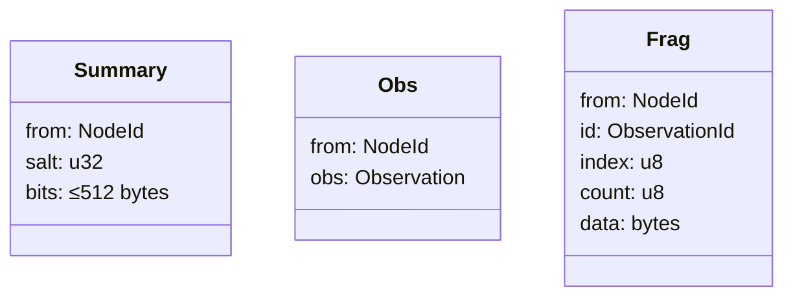
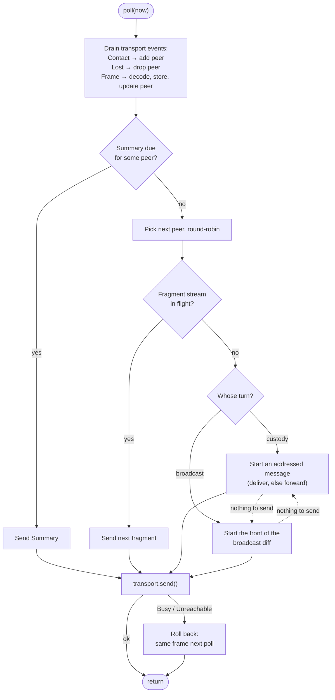
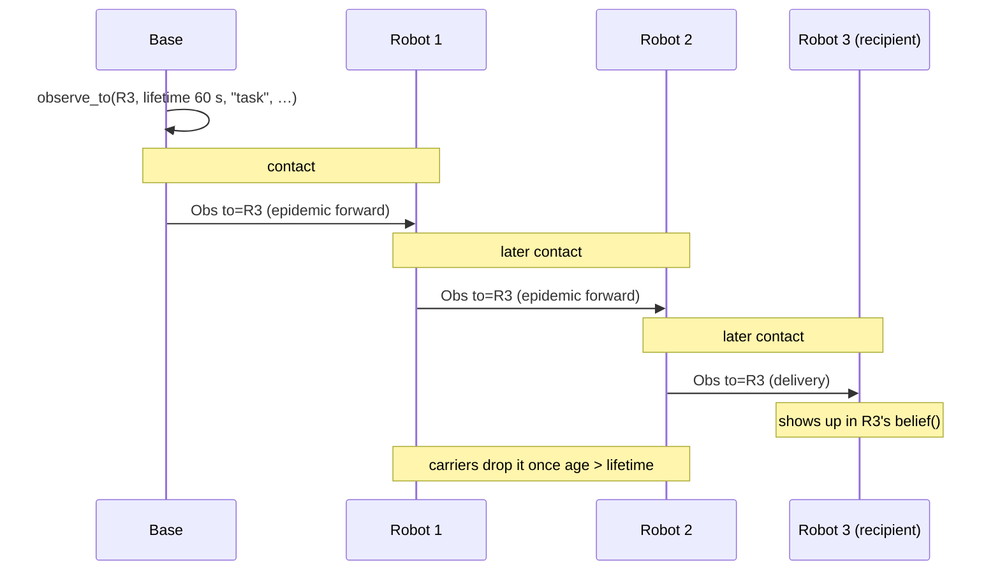

# tines — opportunistic shared memory for mostly-offline robots

Small robots doing their work collect facts about the world. They are mostly
offline, so when two of them happen to meet in range they swap what they know so
that each robot's picture of the world improves over time. No robot *depends* on
receiving anything — it can do its job on its own observations — but there is no
reason not to share.


`tines` is the library that does this: a store of timestamped-by-age
observations, a belief layer derived from them, and a delay-tolerant exchange
protocol that runs over whatever datagram link the robot has. The name is from
Vinge's *A Fire Upon the Deep*: the Tines only form a mind when close enough to
hear each other.

## Contents

- [Design at a glance](#design-at-a-glance)
- [Architecture](#architecture)
- [Observations](#observations)
- [The exchange protocol](#the-exchange-protocol)
- [Addressed delivery](#addressed-delivery)
- [Usage](#usage)
- [Writing a transport](#writing-a-transport)
- [The simulator](#the-simulator)
- [Crate layout](#crate-layout)
- [Building and CI](#building-and-ci)
- [Where to read more](#where-to-read-more)

## Design at a glance

- **Sharing is opportunistic, never load-bearing.** A contact may be cut off
  at any frame. Two nodes' stores converge given enough cumulative contact
  time; no single contact promises anything.
- **Order doesn't matter.** Storage is synced by set union over content-derived
  ids, so a node ends up with the same store whether it met B or C first.
- **The MCU is a first-class target.** `tines-core` is `#![no_std]`, has no
  async, threads, or I/O, and builds without an allocator for
  `thumbv7em-none-eabihf`. Every buffer is fixed-size.
- **Untrusted input never panics.** Every frame off the wire is decoded
  defensively; malformed bytes are dropped.
- **The application sets the pace.** `Node::poll` emits at most one frame per
  call, so duty cycle and airtime are the application's call.

## Architecture

Three layers, each a separate concern, top to bottom:


| Layer   | Holds                              | Crosses the wire? |
|---------|------------------------------------|-------------------|
| memory  | beliefs, recomputed on demand      | never             |
| storage | raw observations                   | yes, by set union |
| comms   | per-peer exchange state            | carries the frames |

Only observations cross the wire. Memory is a pure function of storage plus a
policy and is never transmitted, so two robots can hold different beliefs about
the same facts — that is expected, not a bug.

## Observations

An `Observation` is the unit of storage and exchange:

| Field         | Meaning                                                        | In the id? |
|---------------|----------------------------------------------------------------|:----------:|
| `observer`    | `NodeId` (`[u8; 16]`) of the robot that saw it                 | ✓ |
| `seq`         | the observer's sequence number                                 | ✓ |
| `topic`       | what it is about, ≤ 64 bytes (`b"door/3"`)                      | ✓ |
| `payload`     | opaque bytes, ≤ 1024                                           | ✓ |
| `to`          | `None` for broadcast, or a recipient `NodeId`                  | ✓ |
| `age_ms`      | how old the observation is                                     |   |
| `observed_at` | optional absolute timestamp, if the robot has a clock          |   |
| `lifetime_ms` | validity window, present exactly when `to` is                  |   |

The **content id** is the first 16 bytes of Blake2s-256 over the ✓ fields.
Because age and timestamps are excluded, the same fact arriving by two
different paths, at two different ages, dedupes to one entry.

### Time is relative

Robots don't share a clock, so the protocol carries *age*, not time. Each call
takes a local monotonic `Tick` (milliseconds), and a store reports an
observation's current age as:

```
current_age = age_ms_at_insert + (now − stored_at)      // saturating
```

When an observation is sent, it goes out with its current age, so age keeps
accumulating across hops. A tick that goes backwards (after a reboot, say)
saturates rather than underflowing.

### Sequence numbers must survive reboots

`seq` is part of the id, so a robot must not reuse one for different content.
Persist `Node::next_seq()` and pass it back as `first_seq`, typically as
`boot_count << 32 | counter`. A repeated `seq` with identical content simply
dedupes (`insert` returns `Ok(false)`).

## The exchange protocol

When two robots come into range, both run the same symmetric procedure;
neither is the initiator.



- **Summaries** are 512-byte salted Bloom filters (k = 3). On a narrow link
  the filter is folded down to the largest power of two that fits the MTU. A
  false "peer has it" only delays propagation; the salt changes every round, so
  a different set of ids is affected each time.
- **Diffs** are sent youngest-first, on the theory that short contacts should
  carry the freshest data. Each peer's queue holds up to 256 ids.
- **Every frame is self-contained and idempotent.** Duplicates, reordering and
  loss are all harmless; there is no session state to corrupt.

### Wire frames

Frames are [postcard](https://docs.rs/postcard)-encoded and each carries the
sender's `NodeId`, so the core never needs to map transport addresses to
robots.



### Fragmentation

An observation that doesn't fit the transport's MTU is split into up to 64
`Frag` frames (64 bytes of each frame are reserved for the header). Each peer
has one stream in flight at a time, and it is finished before anything else
starts for that peer. All fragments of a stream are cut from one encoding, so
the receiver can always reassemble them. A partial observation is never
stored; the receiver discards it after 5 s.


### What one `poll()` does

`Node::poll` drains inbound transport events, then emits **at most one**
frame:



## Addressed delivery

Most observations are broadcasts: everyone gets everything. An observation can
also be **addressed** to one robot with `Node::observe_to`, e.g. a tasking from
a base station. Addressed messages travel by store-and-forward: any robot that
meets a carrier becomes a carrier too, until the message reaches its recipient
or its lifetime runs out.



- Addressed messages **never appear in a summary**, so their existence doesn't
  leak to unrelated robots through gossip.
- **Delivery** (the peer is the recipient) is preferred over **forwarding**.
  Custody and broadcast take turns for each peer, so neither can starve the
  other.
- **Bounce suppression:** within one contact, a robot never offers a message
  back to the peer it came from, or to a peer that already has it.
- **Expiry is local and silent.** A message older than its `lifetime_ms` is
  never forwarded and never stored. There are no acks and no cancellation
  messages.
- `belief()` sees broadcasts and messages addressed *to me*. Messages carried
  for others exist only to be forwarded.

## Usage

`tines-core` exposes a single application-facing facade, `Node<S, T>`, generic
over any `Store` and `Transport`:

```rust
use tines_core::{LatestWins, MemStore, Node, NodeId, TrimPolicy};

let me: NodeId = [7; 16];
let boot_count = 0u64;
let counter = 3u64;
let store = MemStore::new();
let transport = /* any Transport implementation */;

// first_seq must survive reboot: boot_count << 32 | counter
let mut node: Node<MemStore, _> = Node::new(
    me,
    boot_count << 32 | counter,
    store,
    transport,
);

// Record something you saw. observed_at is an optional absolute clock
// (ms since epoch); `now` is a local monotonic Tick on every call.
let id = node
    .observe(b"door/3", b"open", Some(1_700_000_000_000), 0)
    .expect("observation fits the size limits");

// Address a tasking to one robot; it is carried until delivered or 60 s old.
node.observe_to([9; 16], 60_000, b"task", b"inspect door/3", None, 0)
    .expect("observation fits the size limits");

// Drive the exchange in your loop. Returns how many new observations were
// stored this round.
let stored = node.poll(500);

// Ask what you believe about a topic prefix, under a belief policy
// (e.g. the youngest observation wins).
let belief = node.belief(b"door", &LatestWins, 500);

// Keep the store bounded.
node.trim(
    &TrimPolicy {
        keep_per_topic: Some(4),
        max_age_ms: Some(3_600_000),
        max_count: Some(10_000),
    },
    500,
);
```

`observe` rejects an oversized topic or payload with `ObserveError::TooLarge`;
nothing is ever truncated.

### Belief policies

A `BeliefPolicy` folds the matching observations, one at a time and in no
particular order, into a single belief. Nothing is buffered, which matters
with 1 KB payloads on an MCU. Two policies ship:

| Policy       | Picks                                                                   |
|--------------|-------------------------------------------------------------------------|
| `LatestWins` | the youngest observation; ties broken by `(observer, seq)`              |
| `SelfFirst`  | my own youngest observation if I have one, otherwise like `LatestWins` |

Write your own by implementing `BeliefPolicy::step` (for example, a majority
vote or a weighted average over payloads). Because beliefs are recomputed from
storage, changing policy never requires touching stored data.

### Trimming

`Store::trim` applies a `TrimPolicy` locally. In order, it keeps the N youngest
observations per topic, drops anything older than `max_age_ms`, then drops the
oldest observations until `max_count` remain. Trimmed ids aren't tombstoned:
if a peer offers one again later, it's accepted.

## Writing a transport

A transport is the boundary with the physical link. It only has to move
datagrams and report who is in range:

```rust
pub trait Transport {
    type Addr: Clone + PartialEq + core::fmt::Debug;
    fn poll(&mut self) -> Option<Event<Self::Addr>>; // Contact | Lost | Frame
    fn send(&mut self, to: &Self::Addr, frame: &[u8]) -> Result<(), SendError>;
    fn mtu(&self) -> usize;                           // ≤ 1500
}
```

- **Datagram semantics.** Frames may be lost, duplicated or reordered; the
  protocol assumes nothing more.
- **Contact detection is the transport's job:** a beacon heard, a link
  coming up, or the simulator saying "in range". A frame from an address with
  no prior `Contact` is treated as an implicit contact.
- **`Addr` is only a routing handle.** It can change mid-contact (DHCP,
  roaming) without harm.
- **Report back-pressure honestly.** Return `SendError::Busy` when the radio
  can't take a frame right now; the exchange will offer the same frame again
  on the next poll. `TooLarge` tells the exchange to give that frame up.

## The simulator

`tines-sim` runs N nodes over a scripted contact trace with seeded loss and
duplication, and is the protocol's test harness:

```rust
use tines_sim::{Contact, ContactTrace, Sim, WorldConfig};

let mut trace = ContactTrace::default();
trace.contacts.push(Contact { start_ms: 0, end_ms: 5_000, a: 0, b: 1 });
trace.contacts.push(Contact { start_ms: 10_000, end_ms: 15_000, a: 1, b: 2 });

let cfg = WorldConfig { nodes: 3, mtu: 512, loss: 0.1, dup: 0.05, seed: 42 };
let mut sim = Sim::new(cfg, trace.clone());
sim.observe(0, b"door/3", b"open");
sim.run_until(trace.end());

assert!(sim.converged(&[0, 1, 2])); // 0 and 2 never met, but 1 carried it
```



```mermaid
gantt
    title The contact trace above
    dateFormat x
    axisFormat %S s
    section 0 ↔ 1
    in range :0, 5000
    section 1 ↔ 2
    in range :10000, 15000
```

The property tests (`tines-sim/tests/props.rs`) generate random traces and
check that:

- every pair of nodes that was ever transitively connected ends up with the
  same broadcast store;
- no store depends on the order of contacts;
- a store only ever grows during a run (union is monotone);
- garbage frames never panic and never change a store;
- addressed messages reach their recipient along a connected path.

`tines-sim/tests/relay.rs` adds scripted relay scenarios, including a message
that expires before it reaches its recipient and is never stored.

## Crate layout

```
tines/
  tines-core/   no_std core: Observation, Store / Transport / BeliefPolicy
                traits, the exchange state machine, the `Node` facade, the
                in-memory store, and the reference belief policies.
                `alloc` is a default feature; without it, tines-core builds
                for thumbv7em-none-eabihf (only MemStore needs alloc).
  tines-sim/    std: the simulator, contact traces, and the convergence /
                order-independence / relay property tests.
```

Fixed limits, all compile-time constants in `tines-core/src/consts.rs`:

| Constant                | Value  | Meaning                                  |
|-------------------------|--------|------------------------------------------|
| `MAX_TOPIC`             | 64     | topic bytes                              |
| `MAX_PAYLOAD`           | 1024   | payload bytes                            |
| `MAX_PEERS`             | 8      | peers tracked at once                    |
| `SUMMARY_BYTES`         | 512    | full Bloom summary size                  |
| `BLOOM_K`               | 3      | hash functions per id                    |
| `SUMMARY_INTERVAL_MS`   | 2000   | re-summary period per peer               |
| `REASSEMBLY_TIMEOUT_MS` | 5000   | partial observation discard time         |
| `SEND_QUEUE_CAP`        | 256    | ids queued per peer                      |
| `MAX_FRAME`             | 1500   | largest frame (and MTU) supported        |

## Building and CI

The toolchain is pinned in `rust-toolchain.toml`. `scripts/ci.sh` runs the full
gate — formatting, clippy and docs (warnings are errors), the test suite with
and without `alloc`, and the `no_std` build for `thumbv7em-none-eabihf`:

```sh
sh scripts/ci.sh
```

GitHub Actions runs the same script on every push to `master` and on every
pull request.

## Where to read more

The specs are authoritative; the plans argue from them.

- **Core design:** `docs/superpowers/specs/2026-10-16-tines-design.md`
- **Addressed delivery:** `docs/superpowers/specs/2026-10-18-tines-addressed-delivery.md`
- **Plans:** `docs/superpowers/plans/`

Not yet built (a second plan): `tines-udp`, `tines-sqlite`, `tines-cli`, and
`tines-serial`.
