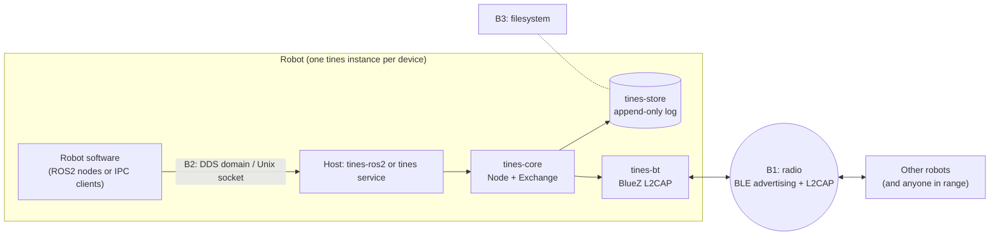

# tines — threat model and security assessment

- **Assessed:** `master` at `3b1a644` (tines-core / tines-store / tines-bt /
  tines-ros2 / tines 0.3.0, fleet-deployment milestone mostly landed)
- **Date:** 2026-10-19
- **Updated:** 2026-10-21 at `411daa0` (`feat/tines-core-1-0`), after the
  tines-core 1.0 review fixes landed. Earlier update: 2026-10-20 at
  `89041ea`, after the fleet fixes. The findings keep their original text;
  each fixed one ends with a **Fixed** or **Partly fixed** line. §6 adds
  F18, found in the fleet re-check, and F19, found with the 1.0 trusted-time
  work.
- **Status:** living document. It's not a spec: update it when the code or the
  trust assumptions change.
- **Related:** the 1.0 spec (`docs/superpowers/specs/2026-10-18-tines-1-0-design.md`),
  especially §2a (signature slot) and §2b (age and the 1.1 threat model).

Every finding below was checked against the source; `file:line` references
are to `3b1a644` unless a line says otherwise.

## 1. Summary

tines v1 has **no trust layer by design**. The core spec lists security as a
non-goal for v1, and the fleet spec repeats "v1 has no trust layer". So most
of what an attacker can do today is expected:

- Anyone in radio range can read everything.
- Anyone in radio range can inject observations under any identity.
- Anyone in radio range can take custody of addressed messages.

That's acceptable while the fleet operates in a trusted RF environment, and
not otherwise. Signing arrives in 1.1 (spec §2a), and link authentication is
the likely 1.1 mechanism for everything that changes per hop (spec §2b).

Separate from the by-design gaps, the assessment found defects that matter
**now**, even with no attacker present. Several are correctness bugs that
the fleet milestone needs fixed regardless of security:

| # | Severity | Finding |
|---|---|---|
| F1 | **High** | A receiver whose store is full still acks, so the sender releases custody of a message nobody kept. |
| F2 | **High** | The standalone `tines` service never polls its `Node`, so it never exchanges anything over BLE. |
| F3 | **High** | `tines-bt` doesn't bind a connection to the advertised NodeId, has no inbound listener, and loses frame boundaries on a stream socket. |
| F4 | **High** | No host calls `LogStore::flush`, and both seed `Node` from the config `first_seq`. Released flags and `next_seq` are never persisted, so seqs repeat after every restart. |
| F5 | Medium | `LogStore` recovery truncates every record after a single corrupt one, and the writer can produce records the reader rejects. |
| F6 | Medium | A peer's NodeId is taken from each frame's `from`, unchecked and changeable per frame, so a peer can claim any identity and be handed that identity's addressed mail. |
| F7–F17 | Medium/Low | Resource exhaustion, amplification, local-IPC and ROS2 exposure, and smaller defects (§6). |

Recommended order: fix F1–F5 in the fleet milestone (they're bugs), harden
the hosts (F10–F12) before any robot leaves the lab, and settle the 1.1
threat questions (§8) before designing signing.

**Fleet fixes, 2026-10-19** (through `89041ea`):

| # | Status | Commit |
|---|---|---|
| F1 | Fixed | `2738de4` |
| F2 | Fixed | `d98895b` |
| F3 | **Partly fixed**: framing, roles, binding and `Contact`/`Lost` are in, but the host is still limited to one configured peer (see F3) | `7df9f41` |
| F4 | **Partly fixed**: seqs and releases are durable, but flushing isn't on a schedule (F18) | `848721a` |
| F5 | Fixed | `4718b6f`, `24b5a78` |
| F17 | Fixed | `6e2dc6f` |

**1.0 fixes, 2026-10-21** (through `411daa0`, on `feat/tines-core-1-0`; not
yet merged or published):

| # | Status | Commit |
|---|---|---|
| F6 | Fixed | `fb71810`, `506d880` (the pin resets on a repeat `Contact`) |
| F8 | Fixed | `fb71810`, `84c79fa` (silent and contact-only peers are evicted) |
| F9 | Fixed | `fb71810`, `a180ec2`, `53f592f` (rate-limit slack) |
| F13 | Fixed (Reassembler displacement accepted, per spec) | `fb71810`, `506d880`, `9362e9f` |
| F18 | **Partly fixed**: the store side is done (flush through the `Store` trait, the caller's tick as the marker, clamping), and both hosts flush right after they first adopt trusted time. Hosts still don't flush on a timer or at shutdown | `c42f5de`, `06a0577`, `039fbf7`, `e4544bf` |
| F19 | **Partly mitigated** (new, 2026-10-21): peer time is chosen by decision J and bounded to a plausible range, but it stays unauthenticated until 1.1 | `039fbf7`, `e4544bf`, `4690bf9`, `03b75f2` |

Still open:
- F10–F12: the host-hardening spec.
- F7 and F14: 1.1.
- F18 (remaining): timed and shutdown flushes, host work (§10).
- F19 (remaining): 1.1 (signatures); until then, a local clock source
  wherever one exists (§6).

## 2. System and trust boundaries

| Boundary | What crosses it | Who can be on the other side today |
|---|---|---|
| **B1 radio** | Advertisements (NodeId in clear), L2CAP frames: Summary, Obs, Frag, Ack | Any BLE device in range. There's no pairing or encryption. Since `7df9f41` a connection is bound to an advertised NodeId on an allowlist, but advertisements are unauthenticated, so anyone can advertise an allowed NodeId. |
| **B2 local IPC / ROS2** | Observations in, beliefs/payloads and events out | Any local user who can reach the socket (permissions come from umask); any participant on the ROS2 DDS domain (no SROS2). |
| **B3 storage** | The observation log: observations, releases, the boot counter | Anyone with write access to the log file. Since `4718b6f` the file is created `0600` (its directory `0700` when the store creates it) and locked against a second opener. |
| Core ↔ transport | `Addr`, raw frames | Trusted code. Core relies on the transport to bind `Addr` to a NodeId (AGENTS.md: "core never maps Addr to NodeId"). |

## 3. Assets

1. **World state integrity:** the facts robots plan and navigate on. Forged
   or stale facts can make a robot act wrongly.
2. **Directive integrity and delivery:** addressed messages (tasks,
   telemetry home), including that they arrive, arrive once, and don't
   outlive their lifetime.
3. **Custody:** "every unexpired addressed message has at least one holder".
4. **Availability of exchange:** contacts are rare and short; wasting one is
   costly.
5. **Robot resources:** RAM (MCU-class targets), disk, battery, airtime.
6. **Identity:** which robot said what (`observer`), which robot is on the
   other end of a link.
7. **Confidentiality:** world state and directives (not a v1 goal) and
   robot location/movement privacy (stable advertised NodeId).
8. **Durability:** the log, the released set and `next_seq` across reboots.

## 4. Adversaries

| Adversary | Capabilities | In scope for |
|---|---|---|
| **A1 radio outsider** | No fleet key. In BLE range: listens, advertises any NodeId, connects, injects arbitrary frames, replays, floods. Can't easily alter frames in flight on an established link, but can impersonate a peer. | v1 assessment; 1.1 design |
| **A2 compromised robot (insider)** | Valid fleet member (and, from 1.1, a valid key). Can already drop, delay or withhold anything it carries; custody accepts carrier failure. | 1.1 design (what signatures do and don't buy) |
| **A3 local user / process** | Unprivileged account or process on the robot's computer. | Host hardening (now) |
| **A4 ROS2 domain participant** | Any process on the same DDS domain, local or on the network the ROS graph is exposed to. | Host hardening (now) |
| **A5 physical / storage access** | Can read or edit the log, swap the SD card, or power-cycle the robot at will. | Partially (integrity and crash safety); full physical attack is out of scope |
| **A0 no adversary** | Faults only: power loss, full disk, full store, radio loss, clock jumps. | Always. Several findings below are A0 bugs. |

Out of scope: side channels, RF jamming (physical-layer DoS can't be fixed
in software), compromise of BlueZ/the kernel, and supply chain.

## 5. Security properties: claimed vs actual

The third column is the original assessment. The fourth is the state after
the fleet fixes.

| Property | Claimed (specs/AGENTS.md) | Actual at `3b1a644` | At `89041ea` |
|---|---|---|---|
| No panic on untrusted input (core) | Hard constraint | **Holds** as far as reviewed: saturating age arithmetic, guarded shifts and indexing, `expect`s unreachable from wire input (exchange.rs:437, 1092; frag.rs:147). The sim's `garbage_frames_never_panic` covers random bytes only (§9). | Unchanged. |
| Malformed frames dropped | Hard constraint | **Holds** in core (wire.rs:64-69). The 1.0 spec adds reporting. | Unchanged; 1.0 adds reporting. |
| Bounded memory in core | Fixed-capacity buffers | **Holds** for the exchange (§6 table). **Doesn't hold for the system**: MemStore and LogStore are unbounded without `trim`, and no host calls `trim` (F10). | Unchanged in practice: the service calls `trim` with an empty default policy, tines-ros2 never does (F10, F18). |
| Custody: ≥ 1 holder (no carrier failure) | Fleet spec, sim property | **Breaks without an attacker** when a store is full (F1). Breaks trivially under A1 (F7). | Holds without an attacker (F1 fixed, with a sim property). Still breaks under A1 (F7). |
| Frames bound to the advertised NodeId | Fleet spec ("frames whose `from` differs … are dropped at the transport") | **Doesn't hold** (F3, F6). | **Holds at the transport** for tines-bt (F3), against unauthenticated adverts. Since 1.0 (`fb71810`, `506d880`) core also pins a peer's NodeId to its first frame in a contact and drops, and counts, a frame whose `from` differs (F6). |
| Released messages not re-forwarded after reboot | Fleet spec | **Doesn't hold**: release flags are never flushed (F4). Safe direction (duplicate custodian), but wasteful. | **Holds**: `Release` records are appended at once (not fsynced until the next flush, so a power cut can still lose one). |
| `next_seq` persisted across reboots | Core contract | **Doesn't hold** in either host (F4). | **Holds**: a persisted boot counter seeds `first_seq` in both hosts. |
| Age continues across reboot | Fleet spec | Partly. Hosts open the store at tick 0, and the service's tick is wall-clock *seconds* (F17). | Partly. Monotonic ms (F17 fixed) and clock markers fold age across a restart, but only up to the last flush, which may be long ago or never (F18). Since 1.0 the downtime itself is folded in once the host has trusted wall time; without it, held addressed messages expire and broadcasts are floored (F18, F19). |

## 6. Findings

Severity reflects impact on the fleet as it's meant to be deployed (trusted
RF, single-user robot computers) unless stated. "By design (v1)" marks
attacker capabilities that follow from having no trust layer; they're
listed so the 1.1 work can check them off.

### F1 — Full store acks what it didn't keep (High, A0/A1)

`Exchange::accept` enqueues an ack for every receive except a released
duplicate, including when `insert` fails (exchange.rs ~805-813, comment:
"even an un-stored id"). `Err(Full)` counts as a duplicate and
`released` is false, so the ack goes out. The sender then releases custody
of a message the receiver didn't keep.

- **Effect:** an addressed message is lost with no carrier failure. This
  violates the custody invariant the fleet spec and sim property rely on.
  An attacker doesn't need to do anything clever: filling a robot's store
  (F10) turns it into a custody sink.
- **Why it's not caught:** `MemStore` never returns `Full`, and the sim uses
  `MemStore`.
- **Fix:** never ack an addressed observation unless `insert` returned
  `Ok(_)` (and, for duplicates, the copy isn't released). Add a sim/unit
  test with a store that returns `Full`. This was the fleet spec's own rule
  ("B never acks a … store-full receive").
- **Fixed:** `2738de4`.

### F2 — The standalone service never runs the exchange (High, A0)

`tines/src` never calls `Node::poll` or `Node::trim` (grep; the plan calls
for a poll loop, `docs/superpowers/plans/2026-10-18-tines-fleet-deployment.md:209`).
`serve()` only answers IPC requests.

- **Effect:** a non-ROS2 robot never sends or receives anything. Inbound BLE
  data accumulates in an unbounded channel (F10).
- **Security relevance:** availability, plus unbounded memory growth while
  connected. Mostly a functional bug.
- **Fix:** a poll loop (with `trim` on a schedule and `flush` after
  releases), off the IPC thread or interleaved with it.
- **Fixed:** `d98895b` (runs inline in `serve` — the node isn't `Send`, so no
  separate thread).

### F3 — tines-bt: no identity binding, no listener, no framing (High, A0/A1)

- `read_loop` stamps every inbound chunk with `from: peer`, where `peer`
  comes from config (tines-bt/src/transport.rs:340-363). The drop check
  `if from != self.peer` (transport.rs:113-115) therefore never fires,
  whichever device connected.
- The scanner connects to the first device advertising the tines service
  UUID and never decodes or compares the advertised NodeId
  (transport.rs:290-308). There's no allowlist.
- There's no `L2capListener`, so nothing accepts inbound connections, and
  `is_central` is never consulted. Every instance dials out. Two robots
  can only connect if something else accepts.
- The L2CAP socket is in **stream** mode and each `read()` result is
  treated as one frame (transport.rs:345-356). Frame boundaries aren't
  preserved, so frames can be split or merged. Without an attacker, that
  produces sporadic malformed drops. With the 1.0 drop reporting, it would
  also produce false "malformed" alarms.
- `Contact`/`Lost` events are never emitted, so core's per-contact state
  (bounce records, ack validation "this contact", peer removal) never
  resets (see F8).
- No BLE security level (pairing, encryption, LE Secure Connections) is
  requested.

**Fix (fleet milestone):**
- Use SeqPacket L2CAP, or add explicit length-prefix framing.
- Add a listener plus the smaller-NodeId-initiates rule.
- Decode the advertised NodeId and bind the connection to it.
- Drop frames whose `from` differs from the bound NodeId.
- Emit `Contact`/`Lost`.
- **Partly fixed:** `7df9f41` (SeqPacket framing, advertise+scan roles,
  UUID-checked NodeId binding, `frame_sender` from-check, `Contact`/`Lost`).
  Re-checked at `89041ea`:
  - The fleet-fixes spec's allowlist (empty = any tines advertiser) and
    multi-peer support aren't reachable. The service config still takes one
    required `peer`. `BluerRadio::new` builds the allowlist as exactly
    `{peer}`, and `BtTransport::poll` drops every frame and event whose
    address isn't that peer (tines-bt/src/transport.rs:186-202, 274). The
    radio loop can hold several connections, but only one is ever used, so
    each robot exchanges with one configured partner.
  - Inbound and outbound channels are still unbounded (F10).
  - No BLE security level is requested (unchanged; 1.1).
  - No two-radio check of the SeqPacket path is recorded yet.
    tines-bt/README.md gives the procedure but no result.

**Later (1.1):** authenticate the link (spec §2b). Advertised NodeIds are
unauthenticated, so the binding only becomes meaningful once there's a
handshake.

### F4 — Durability promises aren't kept by the hosts (High, A0)

- No host calls `LogStore::flush` (grep of `tines-ros2/src`, `tines/src`).
  `Meta { next_seq, released }` is only written by `flush`. So the
  released set never reaches disk, and after a restart every released
  message is forwarded again. That's the safe direction (a duplicate
  custodian) but contradicts the fleet spec.
- Both hosts build `Node` with the config `first_seq`
  (`tines/src/main.rs:44-48`, `tines-ros2/src/node.rs:147-149`) instead of
  a persisted value. Core requires `next_seq` to be persisted
  (`boot_count << 32 | counter`). After a restart, seqs repeat. A new
  observation with the same topic, payload and recipient as an earlier one
  then has the same id and **dedupes silently**: the robot reports
  something and it vanishes.
- `LogStore::next_seq` counts *all* inserts, including received ones
  (log.rs:352), so it isn't the node's seq either.

**Fix:**
- Persist the node's `next_seq` (boot counter plus counter), and seed
  `Node` from it.
- Flush on release and on a timer.
- Add a host-level restart test.
- **Partly fixed:** `848721a`. The boot counter seeds `first_seq` in both
  hosts, and releases are appended as records immediately. Flushing isn't
  on a schedule, though; see F18.

### F5 — Log recovery can destroy good data (Medium, A0/A5)

- `LogStore::new` stops replay at the first record that fails to parse and
  truncates the file there (log.rs:180-206). A single corrupt record in the
  *middle* (a bad sector, a bit flip, a hand edit) deletes every record
  after it. The code comment says "only the partial tail of a crashed
  append is lost, never a complete record", which is true only for tail
  damage.
- `write_record` doesn't enforce `MAX_RECORD_BYTES` (log.rs:274-281), but
  the reader rejects longer records. A `Meta` record grows by 16 bytes per
  released id, so above roughly 500 released ids the store writes a record
  that makes it truncate itself on the next open.
- There's no checksum, so silent corruption that still decodes is accepted.
  The stored `id` is trusted without recomputing `obs.id()` (log.rs:154).
- There's no file locking. Two processes on one log interleave appends, and
  one's recovery `set_len` can cut the other's records.
- The log is read whole into memory (log.rs:127). The file is created with
  umask permissions, and the truncation isn't fsynced.

**Fix:**
- Add a per-record CRC (or a keyed MAC later).
- On a bad record in the middle, skip to the next valid one (a sync marker)
  instead of truncating; truncate only a torn *tail*.
- Enforce the size cap on write, and keep `Meta` small (store release
  flags per record, or compact).
- Take an exclusive `flock` on open.
- Create the file with mode `0600`.
- Recompute ids on load.
- **Fixed:** `4718b6f` + `24b5a78` (format v1: header, per-record CRC-32C,
  sync marker + skip-corrupt recovery, torn-tail truncation + dir fsync,
  `flock`, 0600, recomputed ids).

### F6 — Peer identity is whatever the last frame said (Medium; High combined with F3)

`on_frame` sets `peer.id = Some(frame.sender())` on every frame, unchecked
(exchange.rs:723). The `from` field inside Obs/Frag is ignored, and
`observer` is never compared to anything.

- **Effect (A1):** send one frame with `from = X`, and `forward_addressed`
  hands you every message addressed to X (exchange.rs:584-593), as
  "delivery". Combined with F7 you can then ack them, and the honest
  carrier releases them.
- **Design note:** core deliberately leaves the `Addr` ↔ NodeId binding to
  the transport, so this is F3's consequence. Still, core could cheaply
  refuse a NodeId *change* for an existing peer within a contact, and
  should, once the transport binds identities.
- **Fixed in `fb71810`, `506d880`:** the first decoded frame in a contact
  pins `peer.id`. A later frame with another `from` is dropped and counted as
  `DropReason::IdentityChanged`. The pin resets on `Lost` and on a repeat
  `Contact`.

### F7 — Custody can be taken by anyone the carrier sends to (Medium; by design v1)

An ack is accepted if it comes from the address the message was sent to
(bounce `Sent` record, exchange.rs:756-784). Under the custody chain, a
carrier hands an addressed message to *any* peer with a known id
(exchange.rs:594-595), then releases on that peer's ack. A1 can collect
custody of every addressed message in range and drop it.

- That matches "carrier failure" (accepted for v1) but needs no key and no
  compromise. 1.1's link authentication limits it to fleet members (A2),
  where it really is carrier failure.
- Also: repeated Acks produce duplicate confidence events (`bcast_sent`
  isn't consumed).

### F8 — Peer-table lockout (Medium, A1)

`MAX_PEERS = 8`. Peers are added on `Contact` or on the first decodable
frame, and removed only on `Lost` (exchange.rs:674-708). A full table drops
all frames from new addresses. There's no idle eviction. With BLE never
emitting `Lost` (F3), entries effectively never leave on real hardware.
(Since `7df9f41` tines-bt emits `Lost`, so honest peers leave; spoofed
addresses on other transports still can't be evicted.)
Eight spoofed addresses lock a robot out of exchange until restart.

**Fix:** idle-timeout eviction in core (a local constant), and real
`Lost` events from tines-bt.
- **Fixed in `84c79fa`** (first attempt `fb71810` evicted only the peer that
  had just sent): a peer with no inbound frame for `PEER_IDLE_MS` (30 s),
  counted from its contact if it never sent, is removed as if `Lost`. Idle
  peers are swept before a peer is added and at the start of every
  `next_frame`, so eight silent or contact-only addresses can't hold the
  table.

### F9 — Summary amplification (Medium, A1)

A Summary of about 20 bytes with an all-zero filter makes the receiver
rebuild that peer's send queue with up to 256 of its youngest broadcasts
(exchange.rs:1065-1125). Each one can be up to 64 fragments, so the worst
case is about 16,000 frames of airtime per crafted summary. That's
throttled to one frame per `poll`, but sustained. Re-sending the summary
re-queues what was already sent.

- Each rebuild also scans every broadcast and clones payloads, which costs
  CPU and allocation per summary, with no rate limit.
- **Fix** (as amended in spec §10, 2026-10-20 and decision L):
  - Rate-limit summary processing per peer: act on at most one summary per
    `SUMMARY_INTERVAL_MS`. To allow for poll jitter, a summary is accepted
    once at least `SUMMARY_INTERVAL_MS / 2` has passed since the last one
    acted on, which still bounds replay to two per interval.
  - The send-queue rebuild skips ids the peer's filter says it holds
    (`Bloom::might_contain`). Output per received summary stays bounded by
    `SEND_QUEUE_CAP`.
  - It doesn't skip ids already sent this contact. "Sent" doesn't mean
    "received", so a peer that lost an id must get it again on its next
    summary.
- **Fixed in `fb71810`, `a180ec2`, `53f592f`.**

### F10 — Unbounded growth (Medium, A0/A1/A4)

- `MemStore` and `LogStore` are bounded only by `Node::trim`. Neither host
  calls it. The log also never compacts (log.rs: append-only, and every
  flush appends the full released list).
  - *At `89041ea`:* the service calls `trim` with `TrimPolicy::default()`,
    which removes nothing; tines-ros2 never calls it. Releases are now one
    small record each rather than a growing list, but the log still never
    compacts.
  - *At `411daa0`:* `LogStore` rewrites the log as a snapshot at every open
    and after the wall-clock fold (`06a0577`), which compacts it. Between
    those points it only grows, and the trim policy is still empty.
- Unbounded channels: tines-bt's inbound and outbound `mpsc`
  (transport.rs:207-208), and tines-ros2's inbound `mpsc` (node.rs:152).
- The IPC server allocates up to 1 MiB per request frame.
- **Effect:** A1 can fill memory and disk by gossiping junk. A4 can do it by
  publishing on a bridged topic. Either drives F1 (store full) once a
  bounded store exists.
- **Fix:**
  - Hosts trim on a schedule with a documented default policy.
  - Use bounded channels (drop or backpressure).
  - Add log compaction.
  - Add per-peer and per-observer insert quotas (for example, a per-peer
    token bucket on new inserts).

### F11 — Local IPC is open to any local user (Medium, A3)

- The socket gets umask permissions, and there's no `SO_PEERCRED` check
  (tines/src/ipc.rs:194-200; grep finds no `set_permissions` or peer-cred
  code).
- Any local process that can reach it can:
  - publish observations **as this robot** (`Observe`), which are then
    gossiped fleet-wide under its identity;
  - read any belief;
  - drain the shared event queue, destructively.
- The configured socket path is unlinked unconditionally before binding,
  whatever file is there (ipc.rs:197).
- **Availability:** clients are served one at a time with no timeouts, so
  an idle client blocks everyone. An `accept` error ends the daemon. An
  oversized frame (> 1 MiB) gets an error reply without consuming its body,
  which desynchronizes the stream (contrary to the module docs).
- **Fix:**
  - Create the socket in a `0700` runtime directory with mode `0600` (or a
    group-restricted mode).
  - Check `SO_PEERCRED` against an allowed uid/gid.
  - Only unlink a path that is a socket.
  - Set per-connection read timeouts, or serve clients concurrently.
  - Close the connection on an oversized frame.
  - Survive `accept` errors.

### F12 — ROS2 bridge trusts the whole DDS domain (Medium, A4)

- **Read:** any participant on the domain can read the latest payload of
  every bridged topic and every receipt.
- **Write:** any participant can inject observations on a managed topic.
  They're stored and gossiped as this robot's own (`observe(..., None, now)`,
  tines-ros2/src/node.rs:197), with no rate limit.
- SROS2/DDS security isn't mentioned or configured anywhere.
- **Likely self-echo loop:** the node subscribes to the topics it
  publishes, with no filter for its own messages (node.rs:207-238). If DDS
  delivers its own publications back, which the default settings allow
  (not verified on hardware), each republish is re-observed with a new seq.
  That's a feedback loop that grows the log and floods the fleet.
- **Fix:**
  - Ignore local publications (`ignore_local_publications` or a
    publisher-GID filter).
  - Document running with SROS2 enclaves and a dedicated domain id.
  - Rate-limit inbound.
  - Bound the channel.

### F13 — Smaller core defects (Low)

- **Event queue drops newest, not oldest** (`let _ = self.events.push`,
  exchange.rs:777), contrary to its docs and the fleet spec.
- **Pending acks for a lost peer aren't purged** on `remove_peer`. On
  send errors they're re-queued, and since acks go ahead of data, retries
  to a dead peer can starve data frames.
- **Reassembler displacement:** one fragment with a different id or count
  resets a peer's in-progress stream (frag.rs:121-133). Same-address only,
  so it's limited by F3/F6 binding.
- **Trailing bytes:** `postcard::from_bytes` accepts trailing bytes after a
  valid frame. That's harmless now, but the 1.0 vectors should pin
  rejection so the wire format is canonical.
- **Fixed in `fb71810`, `506d880`, `9362e9f`**, with Reassembler
  displacement accepted, per spec §10:
  - the event queue drops the oldest event;
  - removing a peer purges that peer's pending acks, and only its own
    (`506d880`; the first fix purged every peer's);
  - a frame, and a reassembled observation (`9362e9f`), must decode with
    no trailing bytes, or it's counted as `Malformed`;
  - displacement stays as it is: it's same-address only, and the transport
    binding (F3) plus the F6 pin limit who can do it.

### F14 — Belief policies trust attacker-controlled fields (Medium; by design v1)

- `LatestWins` picks the smallest `age_ms` (belief.rs:36-39). An attacker
  sets age 0 to win any topic (see spec §2b).
- `SelfFirst` trusts `obs.observer == me` (belief.rs:75-77). A forged
  observation claiming to be from *this* robot beats everything. Signing in
  1.1 fixes the observer claim. Until then, a host could refuse inbound
  observations whose `observer` is its own NodeId (a robot never needs to
  receive its own observations from a peer if it still holds them).
- First-copy-wins dedupe fixes `age_ms`, `observed_at` and `lifetime_ms`
  forever at a receiver (mem_store.rs:72-75). A huge `lifetime_ms` makes an
  addressed message effectively immortal.

### F15 — No confidentiality, trackable robots (Low for v1; by design)

The BLE link is unencrypted, so world state and directives are readable by
anyone in range. Each robot advertises a stable NodeId in cleartext and is
discoverable (transport.rs:276-282), so it can be tracked across BLE address
rotation. That's the design (the NodeId *is* the rendezvous). If tracking
matters, 1.1+ needs rotating, keyed rendezvous identifiers.

### F16 — The 16-byte id is unkeyed and truncated (Low, A1)

Ids are the first 128 bits of Blake2s-256 (64-bit collision resistance).
Producing a collision with a *specific* existing id needs a second
preimage, which is infeasible, so an attacker can't squat a particular
id. Generic 64-bit collisions are within reach of a determined attacker,
but only between two observations they produced themselves, which gains
nothing. This is acceptable for dedupe. It's the reason spec §2a signs the
full preimage, not the id.

### F17 — Service clock is wall-clock seconds (Medium, A0)

`tines/src/ipc.rs` `now_ms()` returns `as_secs()` from `SystemTime`
(ipc.rs:276-281). Core's `Tick` is monotonic milliseconds.

- Ages advance 1000× too slowly, so addressed lifetimes last 1000× too
  long.
- An NTP step backwards freezes ages, because they saturate.
- The store is opened at tick 0 while requests use epoch values, so the
  first read can add the whole epoch to every age.

**Fix:** use a monotonic millisecond clock (`Instant` since process start)
everywhere in the host, and open the store with the same clock.
- **Fixed:** `6e2dc6f`.

### F18 — Hosts don't flush on a schedule (Medium, A0)

*Found in the re-check at `89041ea`.* `LogStore::flush` writes the clock
marker that carries age across a restart, and it's the only `fsync` for
inserts and trims (log.rs module docs, "Durability contract").

- The service runs `trim` and `flush` only after `POLL_CAP` (64) polls that
  each stored something new (tines/src/ipc.rs:269-279 at `411daa0`). The
  counter advances only while observations arrive, so a robot that is mostly
  offline, the normal case, may never flush.
- tines-ros2 never calls `flush` or `trim`.
- Even when it runs, `flush` wrote `LogStore`'s own tick as the clock
  marker, and that tick advanced only when something new was inserted
  (tines-store/src/log.rs:698). On a quiet robot the marker was stale, and
  the time since the last insert was lost. **Fixed in 1.0** (`c42f5de`):
  `Store::flush(now)` takes the caller's tick, so the marker is the true
  current time at every flush.
- **Effect:**
  - After a restart, every stored observation's age is folded only up to the
    last clock marker. Time since that marker is lost, so facts look fresher
    than they are and addressed messages outlive their `lifetime_ms`, by up
    to the whole previous uptime. That is F17's effect again, by another
    route.
  - On a power cut, observations inserted since the last flush can be lost.
    That includes a robot's own observations, though their seqs aren't
    reused.
- **Fix:** give flush the caller's `now` (proposed for 1.0: `Store::flush(now)`
  and `Node::flush(now)`, replacing `Node::store_mut`), and
  flush and trim on a wall-time schedule (every
  `flush_interval_ms`, from the host's monotonic clock) in both hosts, and
  on clean shutdown. The fleet-fixes spec asked for "a scheduled flush". The
  trim defaults belong to host hardening (F10).
- **Partly fixed in `c42f5de`, `06a0577`, `039fbf7`, `e4544bf`.**
  - **Store side, done.** `Store::flush(now)` takes the caller's tick
    (`c42f5de`). `LogStore` implements it as the trait method, so
    `Node::flush` really writes the marker and fsyncs; before `06a0577` it
    hit the trait's no-op default. An earlier `now` is clamped to the
    store's time anchor.
  - **Flush after first trusted time, done.** Both hosts adopt trusted time
    through `tines::trust::adopt_wall_clock` (tines/src/trust.rs:90-108),
    which flushes right after the fold. So the first marker with a wall time
    reaches disk at once.
  - **Snapshots.** `LogStore` also rewrites the log at open and after the
    fold (decision I), so the fold's results survive a reboot.
  - **Still open (host work):**
    - The service's scheduled trim and flush are still tied to `POLL_CAP`
      productive polls (tines/src/ipc.rs:269-279).
    - tines-ros2 flushes only when it adopts trusted time, and never trims.
    - Neither host flushes on a timer or at clean shutdown. A quiet robot
      that loses power long after its last flush still under-counts the
      time since that flush.

### F19 — Peer-derived trusted time is unauthenticated (Medium, A0/A1)

*Added 2026-10-21, when the hosts gained the peer-time path (Task 10b).*
When a host has no local trusted clock, it estimates wall time from peers'
observations (`observed_at + age_ms`, advanced by local ticks since the
observation arrived), then folds it into the store once. Nothing
authenticates that estimate.

- **Effect:**
  - A time too far **ahead** makes the fold over-count downtime: addressed
    messages expire early, facts look stale, and `observed_at` stamps run
    fast. That's availability loss, not integrity loss.
  - A time **behind** the last clock marker reads as "clock went backwards",
    which takes the unknown-downtime path: held addressed messages expire
    and broadcasts are floored. Also the safe direction.
  - A time behind the truth but still ahead of the marker under-counts the
    downtime, so held ages come out too young. That's the dangerous
    direction (spec §2b, §9). Honest estimates can land here, because age
    is a lower bound.
  - Before the 1.0 review, a forged `observed_at = u64::MAX` overflowed
    `wall + elapsed` in the hosts and the store: a panic in debug, a time
    near 1970 in release (review B3).
- **Mitigated since `039fbf7`, `e4544bf`, `4690bf9`, `03b75f2`:**
  - **Decision J: the latest estimate in a window.** From the first
    plausible estimate, the host collects for `peer_time_window_ms`
    (default 10 s) and then adopts the latest one, so an honest undershoot
    loses to a better estimate. `LogStore::peer_time_estimate` returns the
    latest estimate among observations stored since this open. A forger
    gains nothing over the old smallest-age rule.
  - **Plausibility bounds (review B3).**
    - The hosts adopt only wall times between `WALL_FLOOR_MS`
      (2026-01-01Z) and `WALL_CEILING_MS` (floor + 100 years, about 2126).
      That applies to peers and to the system clock (`tines::trust`).
    - The store drops estimates outside
      `LogStoreBuilder::plausible_wall_ms` before choosing the latest, so a
      forged far-future estimate can't hide the honest ones. Both hosts set
      it.
    - The wall-time arithmetic saturates.
  - **Local sources first.** The service's `trusted_clock = "system"`, and
    tines-ros2's new `trust_system_clock` / `trust_wall_clock`, both take
    priority over peers. A ROS2-only fleet now has a local source.
- **Still open:**
  - Peer time is unauthenticated until 1.1. Within the plausible range, a
    forger can still choose the time, and the window takes the latest
    estimate, forged or not.
  - A wrong-but-plausible time spreads. The robot stamps its own
    observations' `observed_at` from it, and peers without a trusted clock
    can adopt those stamps in turn.
  - The adopted time is corrected only at the next restart, or when a
    local trusted source arrives. Nothing corrects it while the host runs
    (decision J), and on the peer path it's adopted once per run.
- **Mitigation for deployments:** give every robot a local trusted source
  (RTC, GPS, or an NTP-synced clock with the service ordered after
  `time-sync.target`). Signing and verification in 1.1 close the forged
  case.

## 7. Threats by STRIDE, mapped to findings

| | Threat | Status today | Findings | Planned mitigation |
|---|---|---|---|---|
| **S**poofing | Impersonate a robot on the link | Trivial (A1) | F3, F6 | Transport binding now; link auth (1.1) |
| | Forge an observation's `observer` | Trivial (A1, A3, A4) | F11, F12, F14 | Host hardening now; signatures (1.1) |
| **T**ampering | Alter content in transit | No integrity (A1) | — | Signatures cover content (1.1) |
| | Alter age / lifetime | Unprotected | F14, §2b | 1.1 threat-model decision |
| | Alter the log on disk | No integrity (A5) | F5 | CRC now; MAC optional |
| **R**epudiation | Deny having said something | Unattributable | — | Signatures (1.1) |
| **I**nformation disclosure | Read world state / directives | Cleartext (A1, A4) | F12, F15 | Out of scope v1; link encryption candidate |
| | Track robots | Stable NodeId adverts | F15 | Rotating identifiers (post-1.1) |
| **D**enial of service | Lose custody traffic | Easy (A0!, A1) | F1, F7 | Fix F1 now; link auth (1.1) |
| | Lock out peers / waste airtime | Easy (A1) | F8, F9 | Eviction and rate limits now |
| | Exhaust memory / disk | Easy (A1, A4) | F10 | Trim, bounded channels, quotas now |
| | Block local clients | Easy (A3) | F11 | Timeouts, concurrency now |
| **E**levation of privilege | Act as the robot from a local account | Any local user (A3) | F11 | Socket permissions + peer creds now |
| | Act as the robot from the ROS graph | Any domain participant (A4) | F12 | SROS2, domain isolation |

## 8. The age question (for 1.1)

Spec §2b asks whether `age_ms` must be authenticated. This assessment
supports its framing, and adds evidence:

- Today the question is moot. Everything is forgeable, and fixing F14
  needs signatures first.
- After 1.1 signs content, age is the main remaining *freshness* lever:
  stale facts winning `LatestWins`, expired directives coming back to life,
  and fresh facts suppressed. For A1 it's fully exploitable without link
  authentication. For A2 it adds freshness attacks to what a bad carrier
  can already do by dropping.
- **Recommendation for 1.1:** link authentication (handshake plus per-frame
  tag), which removes A1 from age, acks, summaries and identity in one
  mechanism. Accept A2 age forgery as equivalent to carrier misbehaviour,
  and document it. Cross-check against signed `observed_at` where robots
  have clocks.

## 9. Test gaps

The sim covers honest-node custody properties and random garbage frames
(`tests/props.rs:281`, `tests/relay.rs`). It doesn't cover:

- well-formed malicious frames: forged acks, spoofed `from`/`observer`,
  NodeId changes mid-contact (since `37ca04d` the fuzz harness generates
  all three, but in the core harness only; the sim and the hosts don't);
- ~~a store returning `Full` (F1)~~ (covered since `2738de4`: a unit test
  and the full-store custody sim property);
- ~~summary floods and peer-table exhaustion (F8, F9)~~ (covered since
  `37ca04d`, `8ba1e86`: the fuzz harness's adversarial mode replays
  summaries and floods the peer table from 3 × `MAX_PEERS` addresses, and
  the proptest twin checks recovery after `PEER_IDLE_MS`);
- reassembly abuse (now partly covered: the adversarial mode sends
  conflicting, repeated and out-of-order fragment streams);
- a full disk (`LogStore` corruption in the middle, oversized records,
  concurrent openers, and restart and seq continuity are covered since
  `848721a` and `4718b6f`);
- a quiet host restarting without having flushed (F18). `tines-store`
  now tests flushing through the trait, opening three times, and clamping
  (`06a0577`), but no host-level test covers a long quiet run;
- forged peer time beyond overflow and range checks: nothing tests a
  wrong-but-plausible estimate spreading through `observed_at` (F19);
- most of the hosts: IPC abuse, ROS2 injection and self-echo (F11, F12).
  The service now has a two-instance exchange test (`d98895b`), and
  tines-bt has mock-radio tests for framing, binding and contact events
  (`7df9f41`).

The 1.0 fuzz harness (spec §7) has an *adversarial peer* mode since
`37ca04d`, as well as random bytes: structured frames with chosen ids and
identities, checked against the §7 and §10 properties. It runs nightly in CI
(`.github/workflows/fuzz.yml`), with a proptest twin in the PR gate. The
agreed fuzz budget hasn't been run and recorded yet.

## 10. Where each finding is being fixed

| Findings | Where | Spec | Status |
|---|---|---|---|
| F1, F2, F5, F17 | Fleet milestone (M3) | `docs/superpowers/specs/2026-10-19-tines-fleet-fixes.md` | Fixed (§1) |
| F3, F4 | Fleet milestone (M3) | same | Partly fixed; the rest has no spec yet |
| F18 | Store side: tines-core 1.0 and tines-store; timed and shutdown flushes: host work, with or before host hardening | 1.0 spec §4, §9; none yet for the host part | Partly fixed (§1) |
| F10–F12 | Host hardening, before a robot leaves the lab | `docs/superpowers/specs/2026-10-19-tines-host-hardening.md` | Open |
| F6, F8, F9, F13 | tines-core 1.0 | `docs/superpowers/specs/2026-10-18-tines-1-0-design.md` §10 | Fixed (§1); F13's Reassembler displacement accepted |
| F19 | Hosts and tines-store (decision J, plausibility bounds); authentication in 1.1 | 1.0 spec §9, decision J; §2a | Partly mitigated (§1) |
| F7, F14, §8 | 1.1 (threat model, link authentication, signing) | 1.0 spec §2a, §2b | Open |
| F15, F16 | Accepted for now | — | — |

Mark each finding fixed here, with its commit, when it lands.

The remaining F3 work (one configured peer) and F18 are host-only. Neither
blocks tines-core 1.0, but both block a fleet of more than two robots. F19's
remainder waits for 1.1.

## 11. Recommendations, in order

1. **Fleet milestone bugs** (done 2026-10-19, except the F3 and F4
   remainders):
   - F1 (ack only what was stored).
   - F2 (poll loop).
   - F3 (framing, listener, NodeId binding, Contact/Lost).
   - F4 (persist seq, flush).
   - F5 (CRC, recovery that skips rather than truncates, write cap,
     locking).
   - F17 (monotonic ms clock).
   - Each with a regression test.
2. **Host follow-ups:** the F3 multi-peer allowlist and the rest of F18
   (timed and shutdown flushes in both hosts, and trim in tines-ros2).
   Small, and needed before more than two robots share a fleet. The F18
   store side and the flush after first trusted time are done.
3. **Host hardening before any robot leaves the lab:**
   - F10 (trim, bounded channels, compaction).
   - F11 (socket permissions, peer creds, timeouts).
   - F12 (ignore own publications, SROS2 guidance, rate limits).
4. **Core hardening (rides with 1.0):** done on `feat/tines-core-1-0`
   (2026-10-21), publish pending.
   - F8 (idle eviction, including silent and contact-only peers).
   - F9 (summary rate limit with slack; the rebuild skips what the peer's
     filter holds).
   - F13 (event drop-oldest, purge only the lost peer's acks, reject
     trailing bytes; displacement accepted).
   - F6 (refuse NodeId change within a contact).
5. **1.1:**
   - Write the full threat model from §4/§8.
   - Choose link authentication.
   - Add signing per spec §2a (F14, F7), and authenticate peer time
     (F19).
   - Add "replace if better signed" dedupe.
6. **Later:** confidentiality and rotating rendezvous identifiers (F15),
   only if the deployment needs them.
